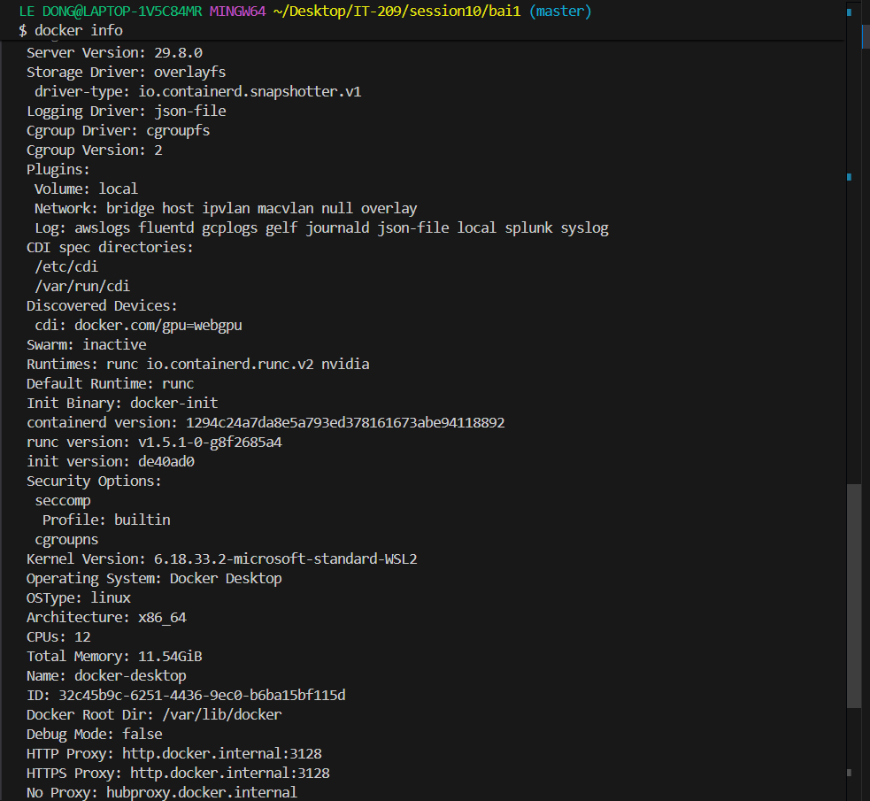
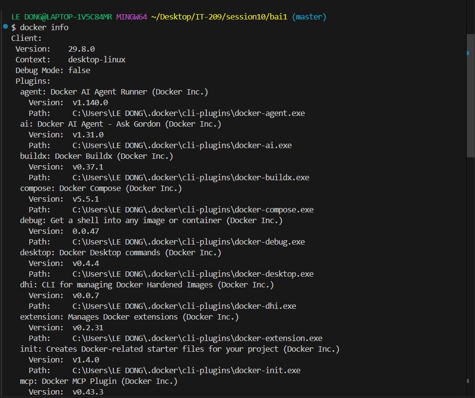

# BÁO CÁO KỸ THUẬT: PHÂN TÍCH KIẾN TRÚC CONTAINER VS VIRTUAL MACHINE (VM)
**Chủ đề:** Đánh giá kiến trúc ảo hóa và phân tích cơ sở kỹ thuật khi doanh nghiệp dịch chuyển từ VPS sang Docker  
**Người thực hiện:** Sinh viên thực tập / Kỹ sư DevOps  
**Môn học:** IT-209 / Quản trị hệ thống & Điện toán đám mây  

---

## 1. Bối cảnh & Đặt vấn đề

Trong mô hình hạ tầng truyền thống, các doanh nghiệp thường triển khai ứng dụng trên máy chủ ảo cá nhân (VPS / Virtual Private Server) hoặc máy ảo (VM) do các nền tảng Hypervisor quản lý. Tuy nhiên, khi doanh nghiệp mở rộng quy mô, mô hình VPS bộc lộ nhiều điểm nghẽn nghiêm trọng:
- **Lãng phí tài nguyên phần cứng:** Mỗi VPS phải gánh một hệ điều hành khách (Guest OS) riêng biệt, tiêu tốn cố định từ vài trăm MB đến hàng GB RAM và dung lượng đĩa cho kernel và các daemon hệ thống dù ứng dụng chạy bên trong rất nhẹ.
- **Tốc độ triển khai & Scale chậm:** Quá trình khởi động, cấp phát một VPS mới mất vài phút, không đáp ứng kịp các đợt lưu lượng truy cập tăng đột biến.
- **Không đồng nhất môi trường (Configuration Drift):** Môi trường thử nghiệm tại máy lập trình viên (Local), môi trường Staging và máy chủ Production thường xuyên xuất hiện lỗi phát sinh do khác biệt phiên bản thư viện và hệ điều hành.

Chuyển dịch sang **Docker Container** là giải pháp chiến lược nhằm giải quyết bài toán trên thông qua việc ảo hóa ở cấp độ hệ điều hành (OS-level virtualization), chia sẻ chung nhân Linux Kernel và đóng gói ứng dụng cùng toàn bộ phụ thuộc thành một đơn vị vận hành thống nhất.

---

## 2. Bảng so sánh chuyên sâu: Virtual Machine vs Container

Dưới đây là bảng phân tích kỹ thuật dựa trên 5 tiêu chí cốt lõi:

| Tiêu chí | Virtual Machine (VM / VPS) | Docker Container | Phân tích tác động kỹ thuật |
| :--- | :--- | :--- | :--- |
| **1. Dung lượng Image** | **Rất lớn (Vài GB đến hàng chục GB)** | **Rất nhỏ (Từ vài chục MB đến vài trăm MB)** | VM yêu cầu đóng gói toàn bộ nhân OS, driver, tiện ích hệ thống (VD: Ubuntu Server ~1-2GB, Windows Server ~10-15GB). Container dùng chung Host Kernel và chia sẻ các Layer, các base image tối ưu (như Alpine Linux) chỉ nặng ~5MB - 50MB. |
| **2. Thời gian khởi động** | **Chậm (Vài chục giây đến vài phút)** | **Tức thì (Mili-giây đến vài giây)** | VM phải trải qua toàn bộ chu trình boot phần cứng ảo, nạp BIOS/UEFI, nạp Kernel và khởi động các dịch vụ init/systemd. Container chỉ đơn thuần khởi tạo một tiến trình mới (Process) trên Host OS nên khởi động gần như ngay lập tức. |
| **3. Hao phí OS (OS Overhead)** | **Cao (Hypervisor + Guest OS)** | **Gần như bằng 0 (Native Process)** | VM cần Hypervisor (Type 1 hoặc Type 2) điều phối tài nguyên và mỗi Guest OS tiêu hao CPU, RAM cho các tiến trình ngầm không phục vụ trực tiếp nghiệp vụ. Container chạy trực tiếp trên Kernel của máy chủ, không có lớp trung gian ảo hóa phần cứng. |
| **4. Mức độ cô lập (Isolation)** | **Rất cao (Hardware-level Isolation)** | **Trung bình - Tốt (Process/OS-level Isolation)** | VM cung cấp tường rào bảo mật tuyệt đối nhờ cô lập phần cứng qua Hypervisor; lỗi kernel ở một VM không ảnh hưởng đến Host. Container cô lập mềm qua cơ chế Namespaces và cgroups; chia sẻ chung Kernel nên nếu Kernel bị tấn công (kernel exploit), rủi ro có thể lan ra Host. |
| **5. Khả năng mở rộng (Scalability)** | **Kém linh hoạt, giới hạn mật độ (Density thấp)** | **Cực cao, mật độ ứng dụng tối đa (High Density)** | Một máy chủ vật lý chỉ có thể chạy được vài chục VM trước khi cạn kiệt RAM/CPU do OS overhead. Với Container, máy chủ có thể chứa hàng trăm đến hàng ngàn container, rất phù hợp với kiến trúc Microservices và tự động co giãn (Auto-scaling với Kubernetes/Docker Swarm). |

---

## 3. Cơ chế cô lập & Quản lý tài nguyên trong Container

Container không phải là một máy ảo, mà bản chất là **một tiến trình Linux tiêu chuẩn được đặt dưới các rào chắn cách ly và giới hạn tài nguyên của Linux Kernel**. Hai trụ cột kỹ thuật cơ bản nhất gồm:

### 3.1. Linux Namespaces (Cơ chế cô lập tầm nhìn - Isolation)
Namespaces quy định những gì mà một container có thể **"nhìn thấy"**, biến tài nguyên toàn cục của hệ thống thành tài nguyên cục bộ riêng biệt cho từng container:

1. **PID Namespace (Process ID):**
   - **Vai trò:** Cô lập cây tiến trình. Tiến trình chính của ứng dụng trong container sẽ mang `PID = 1` (tiến trình gốc), trong khi trên máy chủ Host nó thực tế có một PID hoàn toàn khác (ví dụ: `PID = 45892`).
   - **Tác dụng:** Tiến trình trong container không thể thấy, tương tác hay gửi tín hiệu (`kill`) tới các tiến trình của container khác hoặc tiến trình hệ thống của máy chủ.

2. **NET Namespace (Network):**
   - **Vai trò:** Cung cấp cho mỗi container một stack mạng độc lập hoàn chỉnh, bao gồm bảng định tuyến (routing table), địa chỉ IP riêng, danh sách cổng (ports), và card mạng ảo (virtual network interface - thường là `veth` pair kết nối vào Docker bridge).
   - **Tác dụng:** Hai container khác nhau có thể cùng bind và lắng nghe trên cùng cổng `80` hoặc `3000` mà không xảy ra xung đột cổng mạng (Port Conflict).

3. **MNT Namespace (Mount points & File system):**
   - **Vai trò:** Tạo ra một danh mục gắn kết điểm cây thư mục (Mount Table) riêng biệt cho container. Kết hợp với kỹ thuật `chroot` / `pivot_root` và Storage Driver (như `overlayfs`), container chỉ nhìn thấy hệ thống file (RootFS) riêng của image được cấp phát.
   - **Tác dụng:** Ứng dụng trong container không thể tự ý truy cập hoặc phá hỏng hệ thống tệp tin (`/etc`, `/var`, `/root`) của máy chủ máy chủ hay các container lân cận.

*(Ngoài ra Linux còn cung cấp các Namespaces khác như UTS Namespace cô lập Hostname, IPC Namespace cô lập bộ nhớ chia sẻ, User Namespace ánh xạ UID/GID người dùng).*

### 3.2. Control Groups - cgroups (Cơ chế phân bổ & Giới hạn tài nguyên - Resource Limiting)
Trong khi Namespaces quy định những gì tiến trình được "thấy", thì **cgroups** quy định khối lượng tài nguyên mà tiến trình được phép **"dùng"**:

1. **Giới hạn & Đo lường CPU (`cpu` subsystem):**
   - Phân bổ hạn ngạch CPU thông qua cơ chế CFS (Completely Fair Scheduler). 
   - Thiết lập giới hạn tỷ lệ phần trăm CPU (ví dụ: `--cpus="1.5"`) hoặc chia sẻ trọng số thời gian thực thi (`--cpu-shares`). Đảm bảo một container bị treo vòng lặp vô tận (infinite loop) không thể chiếm dụng 100% CPU làm tê liệt toàn bộ hệ thống.

2. **Giới hạn bộ nhớ RAM & Swap (`memory` subsystem):**
   - Thiết lập trần dung lượng RAM tối đa (ví dụ: `-m 512m`).
   - Giám sát lượng RAM sử dụng thời gian thực. Khi container tiêu thụ vượt quá ngưỡng phân bổ, cơ chế OOM (Out Of Memory) Killer của cgroup sẽ can thiệp để tắt container vi phạm thay vì làm sập toàn bộ máy chủ.

3. **Quản lý I/O đĩa và Băng thông mạng (`blkio`, `net_prio`):**
   - Giới hạn tốc độ đọc/ghi dữ liệu (Read/Write IOPS hoặc Byte/s) xuống ổ đĩa, ngăn chặn hiện tượng nghẽn I/O (I/O starvation) giữa các ứng dụng chạy song song.

---

## 4. Trích xuất thông số thực nghiệm từ hệ thống (`docker info`)

Dưới đây là các thông số vận hành thực tế được trích xuất từ môi trường Docker cục bộ thông qua lệnh `docker info` (và `docker version`):

### 4.1. Bảng tổng hợp thông số cơ bản

| Thông số (Parameter) | Giá trị thực tế trên hệ thống (Extracted Value) | Ý nghĩa kỹ thuật |
| :--- | :--- | :--- |
| **Server Version** | `29.8.0` (Docker Desktop `4.92.0`) | Phiên bản Docker Engine Daemon (dockerd) đang phục vụ tiếp nhận và điều phối các yêu cầu từ CLI client. |
| **Cgroup Driver** | `cgroupfs` (Hỗ trợ Cgroup Version: `2`) | Trình điều khiển giao tiếp với cgroups của nhân Linux. Hệ thống sử dụng driver `cgroupfs` với `Cgroup v2` hiện đại, cho phép quản lý tài nguyên phân cấp và thống nhất tốt hơn. |
| **Containers** | `2` (Running: `2`, Paused: `0`, Stopped: `0`) | Tổng số container hiện hữu trên host. Có 2 container đang chạy hoạt động bình thường, không có container bị tạm dừng hoặc lỗi dừng. |
| **Images** | `2` | Số lượng Docker Image đã tải về hoặc build lưu trữ trong Local Cache (Docker Engine storage). |
| **Storage Driver** | `overlayfs` (containerd snapshotter v1) | Driver quản lý phân lớp (Layered File System) cho images và container layer, giúp tiết kiệm tối đa dung lượng đĩa và nạp container cực nhanh. |
| **Kernel Version** | `6.18.33.2-microsoft-standard-WSL2` | Phiên bản nhân Linux WSL2 bên dưới cung cấp các tính năng cgroups và namespaces cho Docker daemon. |

### 4.2. Khối log thực tế trích xuất từ lệnh `docker info`

```text
Client:
 Version:    29.8.0
 Context:    desktop-linux
 Debug Mode: false

Server:
 Containers: 2
  Running: 2
  Paused: 0
  Stopped: 0
 Images: 2
 Server Version: 29.8.0
 Storage Driver: overlayfs
  driver-type: io.containerd.snapshotter.v1
 Logging Driver: json-file
 Cgroup Driver: cgroupfs
 Cgroup Version: 2
 Plugins:
  Volume: local
  Network: bridge host ipvlan macvlan null overlay
  Log: awslogs fluentd gcplogs gelf journald json-file local splunk syslog
 CDI spec directories:
  /etc/cdi
  /var/run/cdi
 Discovered Devices:
  cdi: docker.com/gpu=webgpu
 Swarm: inactive
 Runtimes: io.containerd.runc.v2 nvidia runc
 Default Runtime: runc
 Init Binary: docker-init
 containerd version: 1294c24a7da8e5a793ed378161673abe94118892
 runc version: v1.5.1-0-g8f2685a4
 init version: de40ad0
 Security Options:
  seccomp
   Profile: builtin
  cgroupns
 Kernel Version: 6.18.33.2-microsoft-standard-WSL2
 Operating System: Docker Desktop
 OSType: linux
 Architecture: x86_64
 CPUs: 12
 Total Memory: 11.54GiB
 Name: docker-desktop
```

### 4.3. Minh chứng thực nghiệm (Screenshots từ hệ thống)

**Log lệnh `docker version`:**


**Log lệnh `docker info` (Xác nhận Server Version, Cgroup Driver, Containers, Images):**


---

## 5. Kết luận & Đề xuất cho doanh nghiệp

1. **Hiệu quả kinh tế & Chi phí (ROI):** Việc thay thế dàn VPS đơn lẻ bằng cụm máy chủ chạy Docker giúp tăng mật độ ứng dụng (Application Density) lên gấp 4 - 8 lần trên cùng một cấu hình phần cứng, giúp doanh nghiệp tiết kiệm 40% - 60% chi phí hóa đơn hạ tầng Cloud hàng tháng.
2. **Chuẩn hóa quy trình CI/CD:** Sử dụng Docker Image đảm bảo tính nhất quán *"Build Once, Run Anywhere"*, loại bỏ hoàn toàn câu nói kinh điển *"Nó chạy được trên máy của tôi nhưng không chạy trên Production"*.
3. **Chiến lược áp dụng:**
   - Các ứng dụng Stateless (Web APIs, Microservices, Frontend SSR) nên được ưu tiên container hóa 100%.
   - Các hệ quản trị cơ sở dữ liệu lớn (Stateful / Enterprise Database) có thể cân nhắc duy trì trên VPS chuyên dụng hoặc dùng giải pháp Managed Database nếu yêu cầu I/O cực cao và an toàn phần cứng tuyệt đối.
